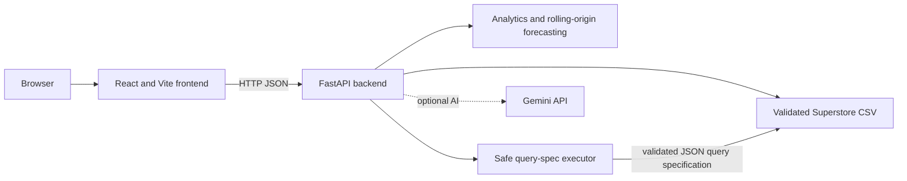
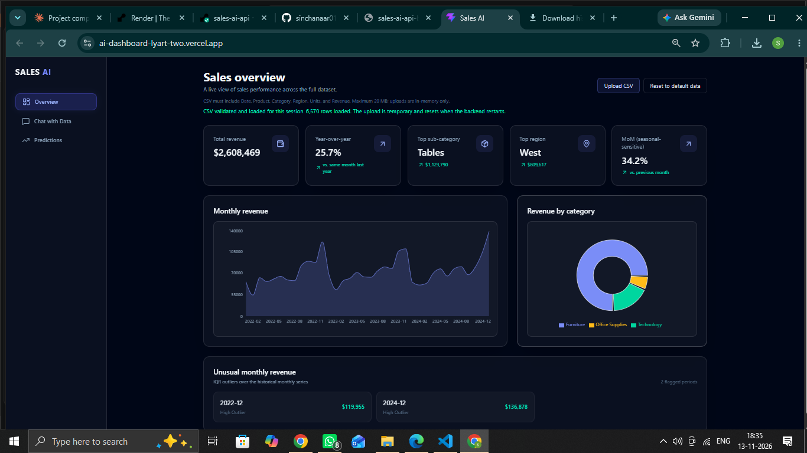

# Sales AI

Sales AI is a sales analytics dashboard with a FastAPI API and a React frontend. It provides revenue KPIs, safe natural-language chart queries, and rolling-origin revenue forecasts.

## Architecture



Gemini can suggest a constrained query specification or provide narrative insights. The backend validates query fields and executes its own allow-listed pandas operations; it does not run generated Python or SQL.

## Tech stack

- **Frontend:** React, Vite, Tailwind CSS, Recharts, ESLint
- **Backend:** Python, FastAPI, pandas, NumPy, scikit-learn, statsmodels
- **Optional AI:** Google Gemini API
- **Deployment:** Render (API), Vercel (frontend), GitHub Actions (CI)

## Dataset

The bundled dataset is the cleaned **Superstore** sample covering **2015–2018** (January 3, 2015 through December 30, 2018). It has 9,994 order rows, 1,850 products, and 17 sub-categories. `data/superstore_source.csv` is the source extract; `data/sales_data.csv` is the cleaned file loaded by the backend. Regenerate the cleaned file by running `python import_superstore.py` from `backend/`.

The Overview KPI uses the highest-revenue sub-category instead of a long product name. For backward compatibility, uploads without a `Sub-Category` column are accepted and assigned `Unspecified`.

## Forecast model comparison

The following table was freshly generated by running `python evaluate_models.py` from `backend/`. Monthly models use one-step rolling-origin evaluation: the first 18 months are used for initial training, then each of the remaining 30 months is predicted in turn. The deployed monthly model is selected by lowest MAE.

| Frequency | Model | Rolling-origin points | MAE | RMSE | MAPE (%) |
|---|---|---:|---:|---:|---:|
| Monthly | Ensemble | 30 | 11359.20 | 14155.19 | 21.64 |
| Monthly | Seasonal Naive | 30 | 12509.45 | 15873.46 | 22.61 |
| Monthly | Gradient Boosting | 30 | 13703.73 | 17270.92 | 26.97 |
| Monthly | Log Holt-Winters | 30 | 13775.74 | 16952.76 | 25.52 |
| Monthly | Holt-Winters | 30 | 14281.50 | 16521.01 | 28.36 |
| Monthly | SARIMA | 30 | 14382.25 | 17747.58 | 31.33 |
| Weekly | Weekly Holt-Winters (52) | 105 | 5307.83 | 6945.75 | 50.44 |
| Weekly | Weekly Seasonal Naive (52) | 105 | 5753.29 | 7709.45 | 54.16 |

The weekly rows are a separate experiment on Sunday-ending weekly revenue sums. They use 104 weeks for initial training and 105 one-week-ahead origins; weekly errors are not directly comparable to monthly errors.
Results may vary slightly with library versions.

## Findings

In this run, the seasonal-naive baseline beats every standalone complex monthly model: its MAPE is 22.61%, versus 25.52% for log Holt-Winters, 28.36% for Holt-Winters, 26.97% for Gradient Boosting, and 31.33% for SARIMA. The equal-weight Seasonal Naive/Holt-Winters ensemble is a separate candidate and wins overall, with 21.64% MAPE, $11,359.20 MAE, and $14,155.19 RMSE.

There are only 48 monthly observations and 30 one-step test origins. Monthly revenue is noisy, leaving the more parameter-heavy models little data to distinguish stable patterns from local variation; their added complexity can overfit instead of generalizing. The ensemble's improvement over the baseline is modest, and should not be treated as a guarantee for future periods or other datasets.

## Safe chat

The chat feature does not execute model-generated code. It asks Gemini for a JSON query specification, then `execute_query_spec` validates the request against allow-lists for dimensions, metrics, filters, sorting, and result limits before performing the aggregation locally. Unsupported fields, code-shaped payloads, and invalid filters are rejected. Gemini is optional; the dashboard's regular analytics and forecasts work without an API key.

## Screenshots

Add current application screenshots at the paths below:




## Local setup

Requirements: Python 3.12 and Node.js 22.

### Backend

From the repository root:

```powershell
cd backend
python -m venv venv
.\venv\Scripts\Activate.ps1
pip install -r requirements.txt
python -m uvicorn main:app --reload
```

The API listens on `http://127.0.0.1:8000`. Copy `backend/.env.example` to `backend/.env` to set local backend variables.

### Frontend

In another terminal:

```powershell
cd frontend
npm ci
npm run dev
```

Vite listens on `http://localhost:5173` and proxies `/api` requests to `http://127.0.0.1:8000` by default. Set `BACKEND_URL` if the development API uses another address.

### Environment variables

| Variable | Where | Purpose |
|---|---|---|
| `GEMINI_API_KEY` | Backend | Enables Gemini-powered chat and narrative insights. Keep the secret in the hosting provider or local `backend/.env`; never commit it. |
| `CORS_ORIGINS` | Backend | Comma-separated allowed frontend origins, for example `http://localhost:5173` or the deployed Vercel URL. |
| `VITE_API_BASE_URL` | Frontend build | Backend base URL used by the deployed frontend, for example `https://sales-ai-api.onrender.com`. Leave unset for local Vite proxying. |

## Deployment

### Render API

1. Connect the repository to Render and deploy the Blueprint from `render.yaml`.
2. Set `GEMINI_API_KEY` as a secret in the Render dashboard.
3. Set `CORS_ORIGINS` to the frontend's deployed origin.
4. Confirm the service starts and its `/` health check responds.

### Vercel frontend

1. Import the repository into Vercel with the project root set to `frontend/`.
2. Use `npm ci` to install and `npm run build` to build; the output directory is `dist`.
3. Set `VITE_API_BASE_URL` to the Render API base URL, then redeploy.
4. Make sure the Render `CORS_ORIGINS` value includes the Vercel deployment origin.

## Tests and benchmark

From `backend/`, run:

```powershell
python -m pytest -q
python evaluate_models.py
```

From `frontend/`, run:

```powershell
npm run lint
npm run build
```

`frontend/package-lock.json` is committed and is required by the CI `npm ci` step.

## Known limitations

- The monthly history is short (48 observations), and the monthly backtest has 30 one-step origins; results can change with a different period or dataset.
- Model selection uses MAE. MAPE is useful as a relative metric but can be unstable for small actuals; zero actuals are excluded.
- The weekly experiment uses one-week-ahead forecasts and weekly dollar errors, not the monthly forecast horizon used in the dashboard.
- Forecast intervals use rolling-origin residual spread with a square-root horizon expansion. They are approximate, not calibrated probabilistic guarantees.
- Models use revenue history only; promotions, pricing, holidays, inventory, and other external drivers are not included.
- CSV uploads are temporary and in-memory, and reset when the backend restarts.
